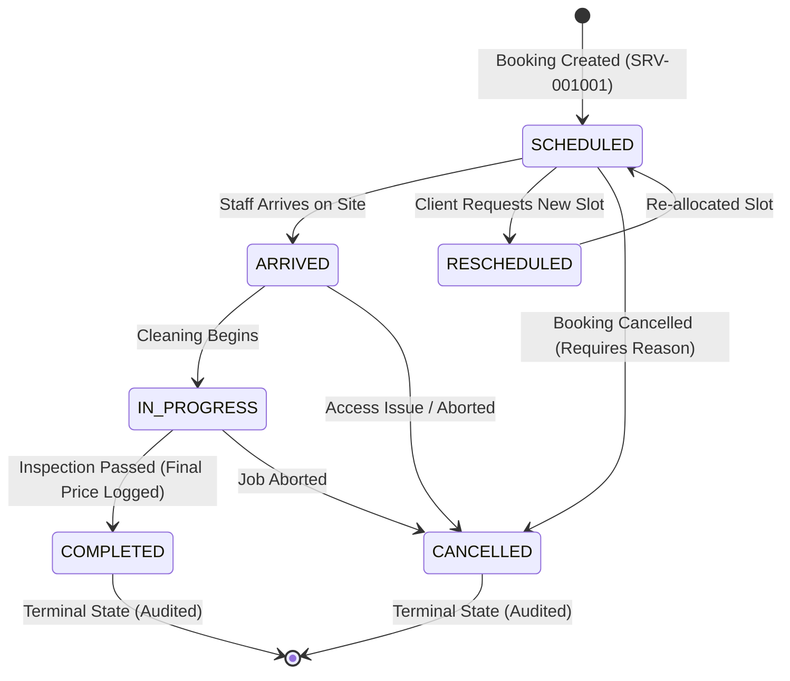
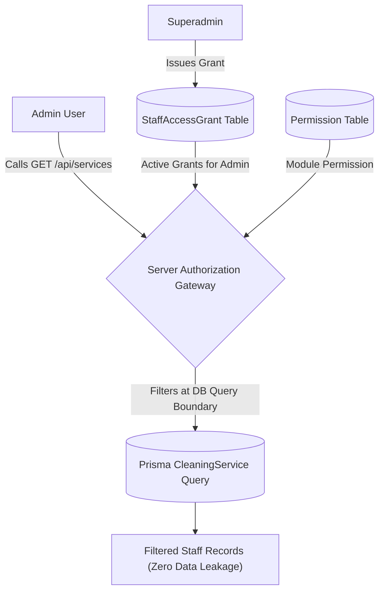

# AEVAN Cleaning CRM — Master Role, Permission & Services Access Control Guide

**Project**: AEVAN Cleaning CRM  
**Target Domain**: `crm.aevancleaning.com`  
**Database**: Supabase PostgreSQL  
**Architecture Version**: Phase 8 Production Release  
**Last Updated**: October 2026  
**Auditor & Architect**: Antigravity Autonomous Engineering Agent  

---

## 1. Executive Overview & Core Invariants

AEVAN Cleaning CRM enforces a strict **Zero-Trust Role-Based and Scope-Based Access Control Architecture** across all 27 business modules and operations.

### Non-Negotiable Invariants:
1. **Superadmin Root Invariant**: Superadmin holds protected, immutable root authority. Superadmin has universal bypass across all modules and cannot be downgraded, disabled, or revoked through UI, API, or database operations.
2. **Zero Implicit Permissions**: Admin and Staff accounts receive **zero default or implicit permissions**. Every capability requires an explicit, audited record in the `Permission` table.
3. **Admin Module vs Staff Visibility Independence**: An Admin possessing `SERVICES:VIEW` permission does **not** automatically see every Staff member's data. Admin visibility over Staff records requires an explicit, active `StaffAccessGrant` issued by Superadmin.
4. **Staff Peer Isolation**: Staff accounts can access only their own assigned records (`OWN` scope). Staff can never access other Staff members' restricted jobs by manipulating URLs or record IDs.
5. **Dual-Ledger & Domain Separation**: Service booking, customer accounts, and supplier operations remain partitioned. Creating a cleaning service does not mutate inventory or create duplicate invoices or ledger entries.

---

## 2. Role Responsibilities & Access Matrix

| Dimension | `SUPERADMIN` | `ADMIN` | `STAFF` |
| :--- | :--- | :--- | :--- |
| **System Scope** | Universal (System Owner) | Scoped Business Manager | Restricted Field Operator |
| **Permission Requirement** | Root bypass (No grants required) | Explicit Database Grants Required | Explicit Database Grants Required |
| **User Administration** | Full CRUD, Role Assignment | Read-only or Restricted | None |
| **Staff Data Visibility** | Universal (Sees 100% of Staff) | Only Superadmin-Authorized Staff | Own Assigned Records Only |
| **Services Management** | Full Booking, Allocation & Override | Permitted Categories & Authorized Staff | View Assigned Jobs & Update Status |
| **Financial Ledgers** | Full Unrestricted Access | Restricted (No Margin Access by Default) | None |
| **Profit Margins Policy** | Unlocked (`VIEW_PROFIT_MARGINS`) | Requires Explicit Action Grant | Strictly Hidden |
| **Stock Ledger Operations** | Full Oversight & Audited Reversals | Trusted Services Only | Delivery & Outward Handling Only |

---

## 3. Dedicated Services Module Architecture

The **Cleaning Services Module** manages the full lifecycle of cleaning jobs, separate from inventory and product merchandising:



### 3.1 Service Information Model (`CleaningService`)
- **Service Number**: Monotonically incremented identifier (`SRV-001001`) via transactional lock.
- **Client Information**: Linked `customerId` or unregistered direct customer with auto-normalized Indian phone (`+91XXXXXXXXXX`).
- **Property & Job Category**: Residential, Commercial, Villa, Office across categories (`DEEP_CLEANING`, `OFFICE_CLEANING`, `SOFA_CLEANING`, `CARPET_CLEANING`, `TANK_CLEANING`, `SANITIZATION`, `FACILITY_MANAGEMENT`, `OTHER`).
- **Scheduling & Allocation**: `scheduledDate`, `timeSlot`, and `assignedStaffId`.
- **Completion Evidence**: `finalPrice`, `completionNotes`, `beforePhotos`, `afterPhotos`, and `followUpDate`.
- **Billing Decoupling**: Tracks `billingStatus` (`UNBILLED`, `INVOICED`, `PAID`) without polluting commercial sales ledgers.

---

## 4. Superadmin Control of Staff Data Visibility

Superadmin governs which Staff members' records an Admin can view or supervise through the `StaffAccessGrant` table:



### 4.1 Access Types
1. **`VIEW` (Staff-Specific View Grant)**:
   - Allows the Admin to view service jobs, arrival times, and history for the authorized Staff member.
   - Does **not** allow reassigning other staff or managing the user account.
2. **`MANAGEMENT_ASSIGNMENT` (Operational Supervision)**:
   - Authorizes the Admin to supervise the Staff member's schedule, assign cleaning jobs to them, and verify completion.
   - Distinct from general user management; does not allow changing roles or passwords.

### 4.2 Five-Point Evaluation Predicate (`evaluateServiceAccess`)
An Admin can access a Staff member's service record only when:
1. Admin is authenticated and active (`isActive: true`).
2. Admin possesses explicit permission on `ModuleName.SERVICES` with `ActionName.VIEW`.
3. Superadmin has granted an active `StaffAccessGrant` for `(adminId, staffId, accessType)`.
4. The record satisfies configured `DataScope` (`OWN`, `ASSIGNED`, `ALL`).
5. Workflow state permits the requested operation.

---

## 5. Data Scope Definitions & Enforcement

Scopes are enforced directly within PostgreSQL queries via Prisma `where` clauses:

- **`OWN`**:
  ```ts
  { createdById: user.id }
  ```
- **`ASSIGNED`**:
  ```ts
  { OR: [{ assignedStaffId: user.id }, { createdById: user.id }] }
  ```
- **`ALL` (For Admin)**:
  ```ts
  { OR: [{ assignedStaffId: { in: authorizedStaffIds } }, { createdById: user.id }] }
  ```
*(Note: An Admin with `ALL` scope still only sees records of Staff members explicitly granted by Superadmin).*

- **`ALL` (For Superadmin)**:
  ```ts
  {} // Universal Root Access
  ```

---

## 6. Financial, Inventory & Separation-of-Duties Boundaries

1. **Party Isolation**:
   - Customer payments never affect supplier accounts payable.
   - Supplier payments never affect customer accounts receivable.
2. **Inventory Neutrality**:
   - Purchase orders and Service bookings do **not** mutate inventory balances.
   - Stock is only decremented through audited outward dispatches or finalized commercial sales.
3. **Separation of Duties**:
   - Expense creators cannot approve their own expenses (`creatorId !== approverId`).
   - Payment reversals require a mandatory non-empty written reason and are strictly idempotent.
   - Profit margins (`ActionName.VIEW_PROFIT_MARGINS`) are stripped from responses for users without explicit grants.

---

## 7. Protected API Endpoints Reference

| Endpoint | Method | Required Module & Action | Staff Visibility Filter |
| :--- | :---: | :--- | :--- |
| `/api/services` | `GET` | `SERVICES:VIEW` | Scoped to caller's authorized staff IDs |
| `/api/services` | `POST` | `SERVICES:CREATE` | Caller must have assignment rights on staff |
| `/api/services/[id]` | `GET` | `SERVICES:VIEW` | IDOR check against authorized staff IDs |
| `/api/services/[id]` | `PATCH` | `SERVICES:EDIT` | IDOR check against authorized staff IDs |
| `/api/services/[id]/status` | `POST` | `SERVICES:EDIT` | State machine transition validation |
| `/api/services/[id]/assign` | `POST` | `SERVICES:ASSIGN` | Requires `MANAGEMENT_ASSIGNMENT` on target staff |
| `/api/staff-access` | `GET` | `USER_PERMISSIONS:VIEW` | Superadmin or Admin viewing own grants |
| `/api/staff-access` | `POST` | Superadmin Only | Superadmin grants `VIEW` or `MANAGEMENT` |
| `/api/staff-access` | `DELETE` | Superadmin Only | Superadmin revokes with reason |

---

## 8. Audit Logging & Security Sanitization

All access changes and service transitions are recorded in `AuditLog` and `PermissionAuditLog`:
- **Recursive Redaction**: Passwords, hashes, JWT tokens, and API keys are scrubbed before persistence.
- **Traceability**: Records caller ID, IP address, user agent, before/after states, and mandatory reasons.

---

## 9. Verification & Test Suite Summary

All 8 automated test suites pass synchronously with zero failures:

```text
▶ SUITE 1 (Phase 1): Security, JWT crypto & Superadmin bootstrap            [26/26 PASS]
▶ SUITE 2 (Phase 2): Products, SKUs, locations & customer validation        [41/41 PASS]
▶ SUITE 3 (Phase 3): Physical outward, delivery notes & stock adjustment    [58/58 PASS]
▶ SUITE 4 (Phase 4): Orders, sales quotations & direct sales                [69/69 PASS]
▶ SUITE 5 (Phase 5): Customer payments, advances, ledger & AR aging         [82/82 PASS]
▶ SUITE 6 (Phase 6): Purchasing, GRNs, bills, returns, AP aging & expenses  [45/45 PASS]
▶ SUITE 7 (Phase 7): Root immutability, data isolation & concurrency audit  [49/49 PASS]
▶ SUITE 8 (Phase 8): Services module, Staff visibility & IDOR isolation     [22/22 PASS]
-----------------------------------------------------------------------------------------
TOTAL COMPREHENSIVE SUITE (npm test):                                      392/392 PASS (100%)
```

- **TypeScript Compilation**: `npx tsc --noEmit` exits with code 0 across all files.
- **Production Build**: `npm run build` compiled all 104 routes with zero syntax or bundling errors.
- **Live Local Test**: Verified on `http://localhost:3005/dashboard/services` (HTTP 200).
